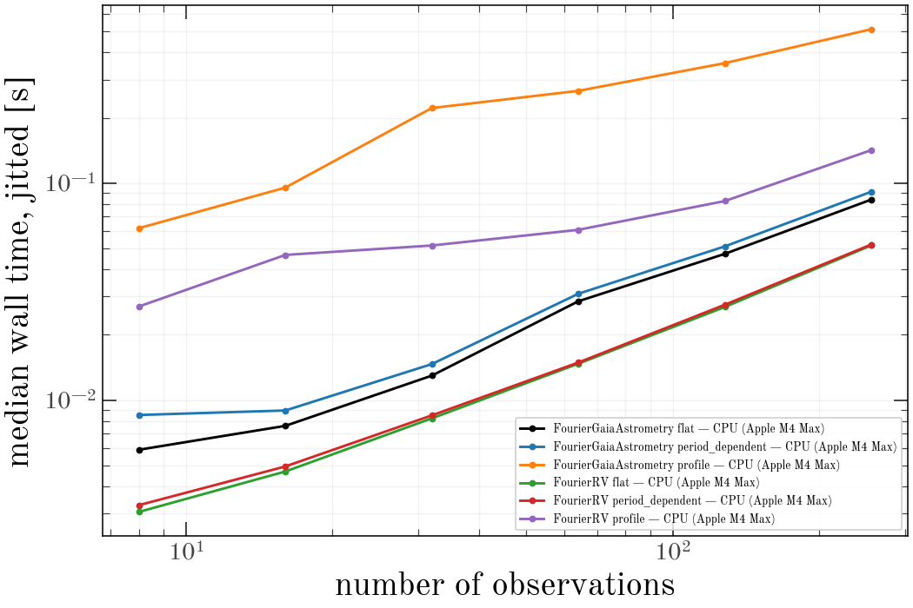
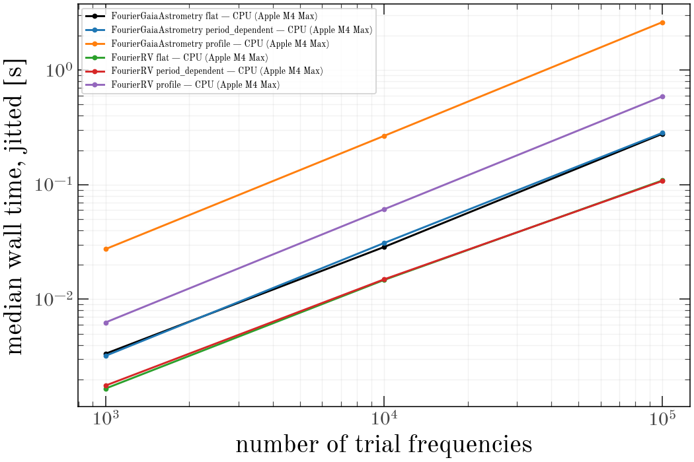

# Periodogram benchmarks

Wall-clock cost of one `harv.periodogram.periodogram` call for a single
source, under `jax.jit`, by model, prior mode, number of observations,
number of trial frequencies, and number of harmonics.

:::{note}
Generated from committed results; not rebuilt with the docs. See
{doc}`running-benchmarks`.
:::

## Run metadata

| device | date | platform | jax | harv | float64 |
|---|---|---|---|---|---|
| CPU (Apple M4 Max) | 2026-10-17 | Darwin / py3.14.8 | 0.8.1 | 0.0.2.dev227+g5b2d5da45.d20261017 | yes |

`flat` is a fixed Gaussian amplitude prior, `period_dependent` a
`LinearPriorCallable` resolved at every trial period, and `profile` is
`prior=False` (amplitudes maximized). `eager` is the median of calling
`periodogram` directly, without `jax.jit`, at the baseline value of the
axis: that is what a one-off call costs, and it is dominated by op-by-op
dispatch rather than arithmetic. `slope` is the log-log exponent of the
jitted times.

## Scaling with number of observations

Held at `n_grid=10,000`, `n_terms=2`.

**CPU (Apple M4 Max)**

| series | 8 | 16 | 32 | 64 | 128 | 256 | slope | eager @ 64 |
|---|---|---|---|---|---|---|---|---|
| FourierRV flat | 3.1 ms | 4.7 ms | 8.2 ms | 14.7 ms | 26.9 ms | 51.6 ms | 0.82 | 82.6 ms |
| FourierRV period_dependent | 3.3 ms | 4.9 ms | 8.5 ms | 14.9 ms | 27.5 ms | 52.1 ms | 0.81 | 91.1 ms |
| FourierRV profile | 27.0 ms | 46.7 ms | 51.6 ms | 60.9 ms | 82.6 ms | 141.8 ms | 0.42 | 103.6 ms |
| FourierGaiaAstrometry flat | 5.9 ms | 7.6 ms | 13.0 ms | 28.5 ms | 47.2 ms | 83.9 ms | 0.81 | 131.5 ms |
| FourierGaiaAstrometry period_dependent | 8.5 ms | 9.0 ms | 14.7 ms | 30.9 ms | 51.1 ms | 91.2 ms | 0.73 | 150.2 ms |
| FourierGaiaAstrometry profile | 61.9 ms | 95.3 ms | 221.6 ms | 266.0 ms | 356.8 ms | 511.4 ms | 0.61 | 315.7 ms |

## Scaling with number of trial frequencies

Held at `n_obs=64`, `n_terms=2`.

**CPU (Apple M4 Max)**

| series | 1,000 | 10,000 | 100,000 | slope | eager @ 10,000 |
|---|---|---|---|---|---|
| FourierRV flat | 1.7 ms | 14.7 ms | 108.8 ms | 0.91 | 82.6 ms |
| FourierRV period_dependent | 1.8 ms | 14.9 ms | 107.7 ms | 0.89 | 91.1 ms |
| FourierRV profile | 6.3 ms | 60.9 ms | 588.7 ms | 0.99 | 103.6 ms |
| FourierGaiaAstrometry flat | 3.3 ms | 28.5 ms | 277.3 ms | 0.96 | 131.5 ms |
| FourierGaiaAstrometry period_dependent | 3.2 ms | 30.9 ms | 283.0 ms | 0.97 | 150.2 ms |
| FourierGaiaAstrometry profile | 27.4 ms | 266.0 ms | 2.62 s | 0.99 | 315.7 ms |

## Scaling with number of Fourier harmonics `n_terms`

Held at `n_grid=10,000`, `n_obs=64`.

**CPU (Apple M4 Max)**

| series | 1 | 2 | 3 | 4 | slope | eager @ 2 |
|---|---|---|---|---|---|---|
| FourierRV flat | 6.5 ms | 14.7 ms | 18.4 ms | 22.0 ms | 0.89 | 82.6 ms |
| FourierRV period_dependent | 6.6 ms | 14.9 ms | 19.0 ms | 22.1 ms | 0.88 | 91.1 ms |
| FourierRV profile | 35.6 ms | 60.9 ms | 93.1 ms | 158.8 ms | 1.04 | 103.6 ms |
| FourierGaiaAstrometry flat | 20.6 ms | 28.5 ms | 36.6 ms | 50.4 ms | 0.62 | 131.5 ms |
| FourierGaiaAstrometry period_dependent | 19.1 ms | 30.9 ms | 35.8 ms | 49.4 ms | 0.65 | 150.2 ms |
| FourierGaiaAstrometry profile | 152.1 ms | 266.0 ms | 385.4 ms | 554.6 ms | 0.91 | 315.7 ms |

## First-call compile cost

Median of `cold - warm` across every cell, the cold call against a cleared
JIT cache. Paid once per distinct data shape.

| device | compile |
|---|---|
| CPU (Apple M4 Max) | 154.1 ms |
