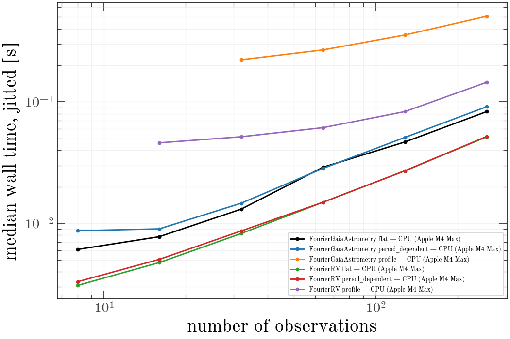
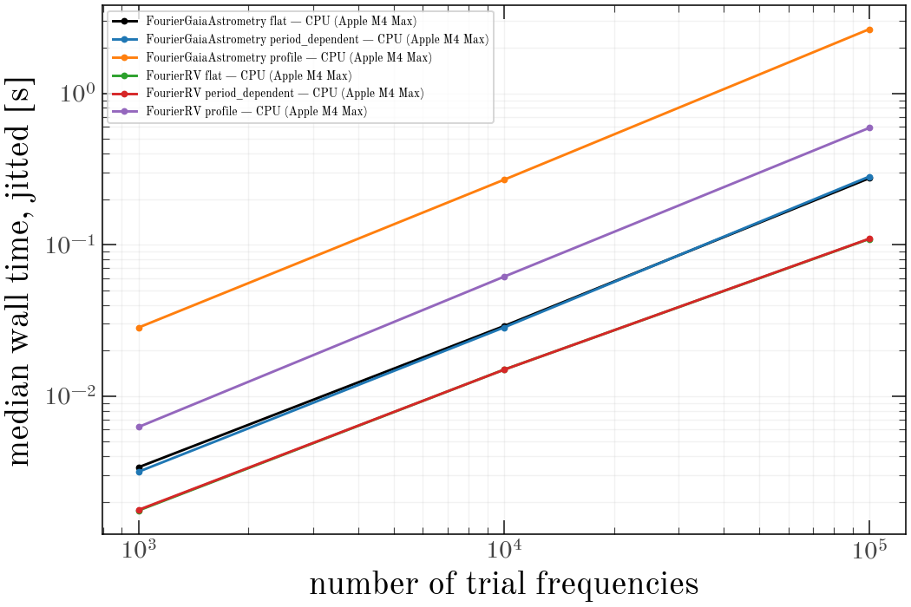

# Periodograms

Wall-clock cost of one `harv.periodogram.periodogram` call for a single
source, under `jax.jit`, by model, prior mode, number of observations,
number of trial frequencies, and number of harmonics.

:::{note}
Generated from committed results; not rebuilt with the docs. See
{doc}`running-the-benchmarks`.
:::

## Run metadata

| device | date | platform | jax | harv | float64 |
|---|---|---|---|---|---|
| CPU (Apple M4 Max) | 2026-10-18 | Darwin / py3.14.8 | 0.8.1 | 0.0.2.dev181+gba91d27bb.d20261018 | yes |

`flat` is a fixed Gaussian amplitude prior, `period_dependent` a
`LinearPriorCallable` resolved at every trial period, and `profile` is
`prior=False` (amplitudes maximized). `eager` is the median of calling
`periodogram` directly, without `jax.jit`, at the baseline value of the
axis: that is what a one-off call costs, and it is dominated by op-by-op
dispatch rather than arithmetic. `slope` is the log-log exponent of the
jitted times. † marks a profile-mode cell where `periodogram` lowered
`n_terms` to keep the trial model overdetermined, so it timed fewer
harmonics than the cell asked for; those cells are left out of `slope`
and the figures.

## Scaling with number of observations

Held at `n_grid=10,000`, `n_terms=2`.

**CPU (Apple M4 Max)**

| series | 8 | 16 | 32 | 64 | 128 | 256 | slope | eager @ 64 |
|---|---|---|---|---|---|---|---|---|
| FourierRV flat | 3.1 ms | 4.8 ms | 8.2 ms | 14.9 ms | 27.0 ms | 51.6 ms | 0.82 | 86.1 ms |
| FourierRV period_dependent | 3.3 ms | 5.0 ms | 8.7 ms | 14.9 ms | 27.1 ms | 51.9 ms | 0.80 | 92.1 ms |
| FourierRV profile | 26.8 ms † | 46.0 ms | 51.7 ms | 61.4 ms | 83.2 ms | 145.1 ms | 0.40 | 103.4 ms |
| FourierGaiaAstrometry flat | 6.1 ms | 7.8 ms | 13.1 ms | 29.0 ms | 46.8 ms | 83.2 ms | 0.79 | 138.8 ms |
| FourierGaiaAstrometry period_dependent | 8.7 ms | 9.0 ms | 14.6 ms | 28.4 ms | 51.0 ms | 91.3 ms | 0.73 | 153.2 ms |
| FourierGaiaAstrometry profile | 61.4 ms † | 94.4 ms † | 222.6 ms | 268.1 ms | 355.8 ms | 507.6 ms | 0.40 | 316.8 ms |

## Scaling with number of trial frequencies

Held at `n_obs=64`, `n_terms=2`.

**CPU (Apple M4 Max)**

| series | 1,000 | 10,000 | 100,000 | slope | eager @ 10,000 |
|---|---|---|---|---|---|
| FourierRV flat | 1.8 ms | 14.9 ms | 109.1 ms | 0.90 | 86.1 ms |
| FourierRV period_dependent | 1.8 ms | 14.9 ms | 109.5 ms | 0.90 | 92.1 ms |
| FourierRV profile | 6.2 ms | 61.4 ms | 590.8 ms | 0.99 | 103.4 ms |
| FourierGaiaAstrometry flat | 3.4 ms | 29.0 ms | 274.8 ms | 0.95 | 138.8 ms |
| FourierGaiaAstrometry period_dependent | 3.2 ms | 28.4 ms | 281.6 ms | 0.97 | 153.2 ms |
| FourierGaiaAstrometry profile | 28.3 ms | 268.1 ms | 2.65 s | 0.99 | 316.8 ms |

## Scaling with number of Fourier harmonics `n_terms`

Held at `n_grid=10,000`, `n_obs=64`.

**CPU (Apple M4 Max)**

| series | 1 | 2 | 3 | 4 | slope | eager @ 2 |
|---|---|---|---|---|---|---|
| FourierRV flat | 6.5 ms | 14.9 ms | 18.6 ms | 22.1 ms | 0.89 | 86.1 ms |
| FourierRV period_dependent | 6.5 ms | 14.9 ms | 18.8 ms | 21.5 ms | 0.87 | 92.1 ms |
| FourierRV profile | 35.1 ms | 61.4 ms | 94.2 ms | 158.5 ms | 1.05 | 103.4 ms |
| FourierGaiaAstrometry flat | 20.6 ms | 29.0 ms | 36.4 ms | 50.7 ms | 0.62 | 138.8 ms |
| FourierGaiaAstrometry period_dependent | 19.6 ms | 28.4 ms | 35.7 ms | 49.3 ms | 0.64 | 153.2 ms |
| FourierGaiaAstrometry profile | 149.1 ms | 268.1 ms | 383.9 ms | 551.5 ms | 0.92 | 316.8 ms |

## First-call compile cost

Median of `cold - warm` across every cell, the cold call against a cleared
JIT cache. Paid once per distinct data shape.

| device | compile |
|---|---|
| CPU (Apple M4 Max) | 157.1 ms |
